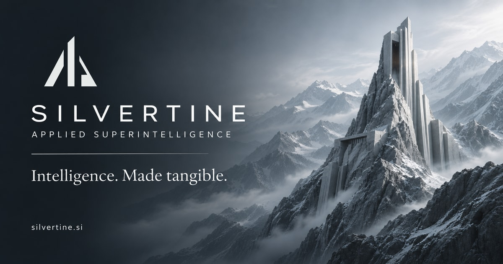

# Silvertine SI

**Applied Superintelligence.**

A responsive first-draft website for Silvertine, an applied superintelligence company. Prepared for **silvertine.si**. Enquiries: **connect@silvertine.si**.



## Deploy to Vercel

Import `civnexus/silvertine`, using the `main` branch. The included `vercel.json` configures:

- Framework preset: **Other**
- Build command: **npm run build**
- Output directory: **dist**
- No environment variables or runtime dependencies required.

After deployment, attach `silvertine.si` in the Vercel domain settings. Canonical URLs, sitemap and social metadata target that domain. WhatsApp/social preview images will resolve once the domain is connected and publicly reachable; platforms may cache older previews. This repository push does not itself provision Vercel or email service.

## Development

Requires Node.js 20 or newer. There are no package dependencies to install.

```sh
npm run check
npm run build
python3 -m http.server 8000 --directory dist
```

Edit `public/index.html`, `public/styles.css`, and `public/site.js`. `scripts/build.mjs` copies only `public/` into `dist/`.

## Design and content

- Alpine silver, dark granite, restrained geometric summit mark, editorial serif typography.
- Original summit citadel, bedrock interior, mountain mission-control, and ascending stair imagery.
- Perspective, development and compute disclosures, mission control, conviction, and private enquiries.
- Brand imagery connects summit foresight, mission control, and an ascending granite stair.
- No fabricated customers, performance statistics, operational facilities, or financial product promises.

## Brand assets

- Vector mark: `public/assets/silvertine-mark.svg`
- Dark wordmark: `public/assets/silvertine-wordmark.svg`
- SVG favicon, ICO fallback, Apple touch icon, 192/512px app icons
- 1200 × 630 JPEG social card: `public/assets/silvertine-share-branded.jpg`
- Responsive WebP assets for all architectural imagery

## Web standards

Semantic HTML and native disclosure controls; keyboard navigation, Escape-to-close menu, focus indicators, skip link, reduced-motion support, responsive breakpoints, image alternative text and intrinsic dimensions. Hero image is prioritized; lower images lazy-load. Fonts are self-hosted. No trackers, external fonts, client libraries, or form processing. Vercel configuration adds security and image-cache headers. Font redistribution license is included beside the font files.

See [QA.md](QA.md) for checks and verification limits.
